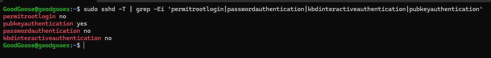
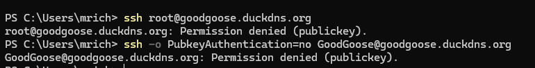
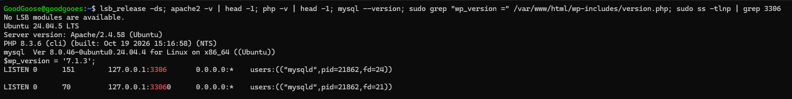
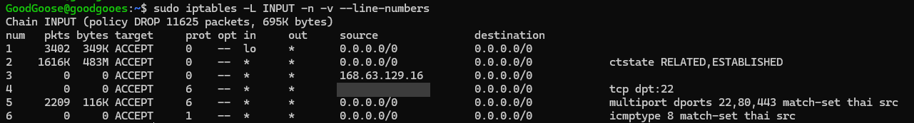
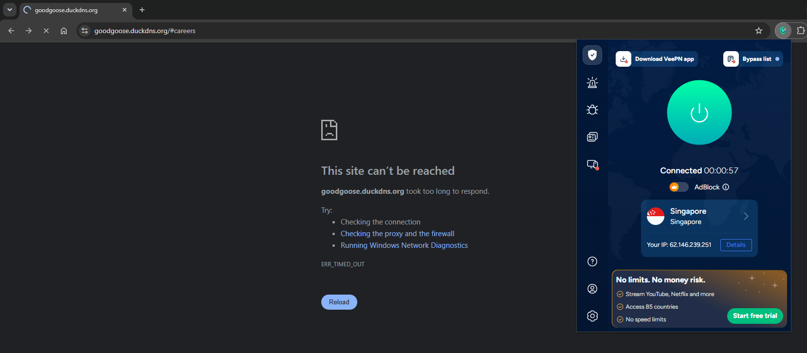
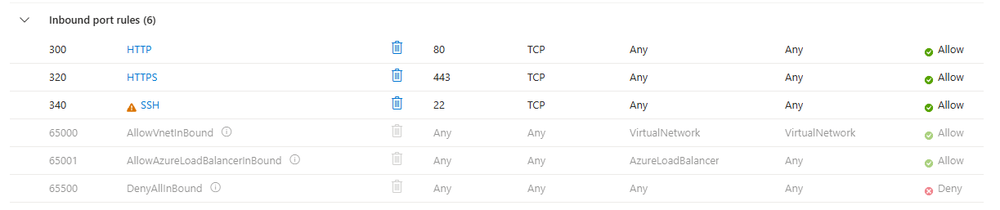
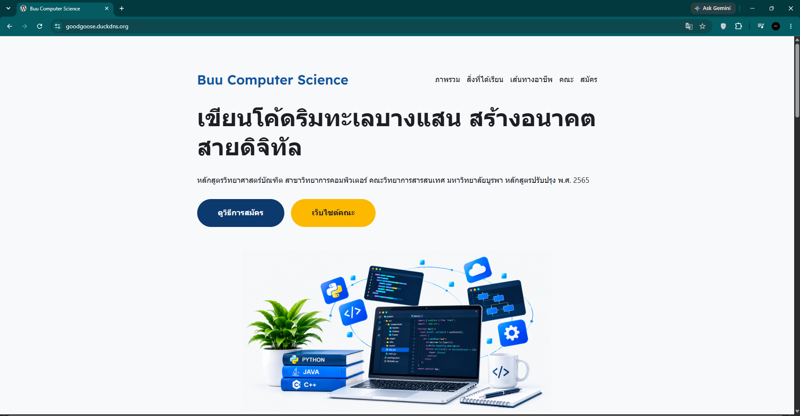

# GoodGoose WordPress on Azure

ติดตั้ง WordPress บน Azure VM ใช้โดเมน DuckDNS พร้อม HTTPS, SSH แบบ key-only และ firewall ที่ยอมให้เชื่อมต่อได้เฉพาะจากประเทศไทย

- เว็บไซต์: https://goodgoose.duckdns.org

## สมาชิกกลุ่ม

| ชื่อ-นามสกุล | รหัสนักศึกษา |
|---|---|
| วริทญ์นันษ์ แสงจันทร์ | 67160057 |
| ณัฏฐนันท์ สิงห์ทองเมือง | 67160064 |
| ปัณณทัต เสือหลง | 67160074 |
| สืบสกุล พรสว่าง | 67160078 |
| พัชรพร ครุธตำคำ | 67160099 |
| สิรวิชญ์ แซ่กัว | 67160108 |
| ปรมินทร์ ดวงเกิด | 67160261 |

## สถาปัตยกรรม

```
ผู้ใช้ (ประเทศไทยเท่านั้น)
  │
  ▼
DNS: goodgoose.duckdns.org (DuckDNS)
  │
  ▼
Azure VM (Japan East) ── Ubuntu 24.04.5 LTS
  ├─ Firewall: iptables + ip6tables + ipset (อนุญาตเฉพาะ IP ไทย, policy DROP)
  ├─ SSH :22   key-only (ed25519) / root ปิด / password ปิด
  └─ Apache 2.4.58 :80, :443 (HTTPS, Let's Encrypt)
        └─ PHP 8.3.6
             └─ WordPress 7.1.3 ──► MySQL 8.0.46 (localhost)
```

| ส่วนประกอบ | เวอร์ชัน |
|---|---|
| OS | Ubuntu 24.04.5 LTS |
| Web server | Apache 2.4.58 |
| PHP | 8.3.6 |
| WordPress | 7.1.3 |
| Database | MySQL 8.0.46 |
| Firewall | iptables, ip6tables, ipset, iptables-persistent / ipset-persistent |

> ก่อนส่งงาน ให้รันคำสั่งในหัวข้อ "ตรวจเวอร์ชัน" อีกรอบ เพราะเวอร์ชันอาจเปลี่ยนหลังอัปเดต

## ด่าน 1: DNS + HTTPS + SSH hardening

ไฟล์: [`config/ssh/00-hardening.conf`](config/ssh/00-hardening.conf)

```bash
sudo cp config/ssh/00-hardening.conf /etc/ssh/sshd_config.d/00-hardening.conf
sudo sed -i 's/^PasswordAuthentication yes/PasswordAuthentication no/' /etc/ssh/sshd_config.d/50-cloud-init.conf
sudo sshd -t && sudo systemctl reload ssh
```

ปัญหาที่เจอ: Azure สร้างไฟล์ `50-cloud-init.conf` ที่ตั้ง `PasswordAuthentication yes` ซึ่งโหลดก่อนและทับค่า `no` ในไฟล์อื่น จึงต้องสร้างไฟล์ `00-hardening.conf` ให้โหลดก่อนสุด

ผลตรวจ:

```
$ sudo sshd -T | grep -Ei 'permitrootlogin|passwordauthentication|kbdinteractiveauthentication|pubkeyauthentication'
permitrootlogin no
pubkeyauthentication yes
passwordauthentication no
kbdinteractiveauthentication no
```

ทดสอบจากภายนอก:

| การทดสอบ | ผล |
|---|---|
| `ssh root@goodgoose.duckdns.org` | `Permission denied (publickey).` |
| `ssh -o PubkeyAuthentication=no user@goodgoose.duckdns.org` | `Permission denied (publickey).` |
| `ssh -i ~/.ssh/id_ed25519 user@goodgoose.duckdns.org` | เข้าได้ ไม่ถามรหัสผ่าน |







## ด่าน 2: Firewall อนุญาตเฉพาะประเทศไทย

ไฟล์: [`config/firewall/setup-firewall.sh`](config/firewall/setup-firewall.sh)

- รายการ IP ไทยจาก ipdeny.com (ประมาณ 1,195 บล็อก) เก็บใน ipset ชื่อ `thai`
- INPUT policy = DROP ทั้ง IPv4 และ IPv6
- กฎที่ยอมรับ: loopback, ESTABLISHED/RELATED, บริการภายใน Azure (168.63.129.16), SSH จาก IP ผู้ดูแล, พอร์ต 22/80/443 และ ping เฉพาะ IP ไทย
- บันทึกถาวรด้วย `netfilter-persistent save`

```bash
sudo bash config/firewall/setup-firewall.sh
```

สคริปต์ตั้งตัวย้อนกลับอัตโนมัติ 10 นาที ถ้ากฎผิดจนเข้าเครื่องไม่ได้ firewall จะเปิดคืนเอง

ผลทดสอบ:

| การทดสอบ | ผล |
|---|---|
| เปิดเว็บจากไทย | เข้าได้ปกติ |
| เปิดเว็บผ่าน VPN สิงคโปร์ / เนเธอร์แลนด์ | `ERR_TIMED_OUT` |
| `iptables -L INPUT -n -v` | policy DROP ทิ้งไปแล้ว 11,625 แพ็กเก็ต |
| IP ต่างประเทศใน Apache log หลังตั้ง firewall | ไม่พบ |









## Security hardening เพิ่มเติม

- `wp-config.php` สิทธิ์ 640
- PHP ได้แพตช์ช่องโหว่ CVE-2026-109618 และ CVE-2026-109619 แล้ว (ตรวจด้วย `apt changelog php8.3-common | grep CVE-2026-10961`)
- ซ่อนเวอร์ชัน Apache/PHP (`ServerTokens Prod`, `ServerSignature Off`, `expose_php = Off`) ผลคือ header ขึ้นแค่ `Server: Apache`
- บล็อกการรัน PHP ในโฟลเดอร์ uploads และปิด `xmlrpc.php`: [`config/apache/security-hardening.conf`](config/apache/security-hardening.conf), [`config/php/99-hardening.ini`](config/php/99-hardening.ini)
- `DISALLOW_FILE_EDIT` ใน `wp-config.php` (ดู [`wordpress/wp-config-sample.php`](wordpress/wp-config-sample.php))
- ลบ `readme.html` และ `license.txt` ออกจาก web root
- MySQL ฟังเฉพาะ `127.0.0.1:3306`, Azure NSG เปิดเฉพาะ 22, 80, 443

## ตรวจเวอร์ชัน

```bash
lsb_release -ds
apache2 -v | head -1
php -v | head -1
mysql --version
grep "wp_version =" /var/www/html/wp-includes/version.php
```

## ข้อจำกัดที่ทราบ

Let's Encrypt ต่ออายุใบรับรองแบบ HTTP-01 ต้องให้เซิร์ฟเวอร์ต่างประเทศเข้าพอร์ต 80 ซึ่ง firewall บล็อกอยู่ ทางแก้คือเปิดพอร์ต 80 ชั่วคราวตอนต่ออายุ หรือเปลี่ยนเป็น DNS-01 ผ่าน DuckDNS

## โครงสร้าง repo

```
├── README.md
├── docs/                         ภาพหลักฐาน
├── config/
│   ├── ssh/00-hardening.conf
│   ├── firewall/setup-firewall.sh
│   ├── apache/security-hardening.conf
│   └── php/99-hardening.ini
└── wordpress/
    ├── wp-config-sample.php      ค่าตัวอย่างเท่านั้น
    ├── theme/                    ธีมที่ export จาก Site Editor
    └── export/                   ไฟล์ XML จาก Tools → Export
```
